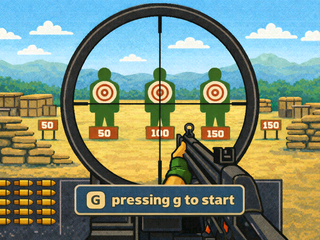

# 3D Shooting

<p align="center">
  <strong>A bare-metal C raycasting shooter for the DE1-SoC, with VGA graphics, PS/2 controls, audio feedback, and seven-segment scoring.</strong>
</p>

<p align="center">
  
</p>

<p align="center">
  <a href="#highlights">Highlights</a> ·
  <a href="#controls">Controls</a> ·
  <a href="#project-structure">Structure</a> ·
  <a href="#build-and-run">Build and run</a>
</p>

3D Shooting renders a compact first-person target game at 320 × 240 using Q16.16 fixed-point DDA raycasting. It drives memory-mapped VGA, PS/2, audio, and HEX-display peripherals directly, without a game engine or floating-point rendering pipeline.

> [!IMPORTANT]
> This is a hardware-dependent application, not a native desktop game. A desktop compiler can validate the source and link the modules, but the resulting host executable must not be run because the game accesses fixed peripheral addresses directly.

## Highlights

- Column-based DDA raycasting with a per-column z-buffer, distance fog, side shading, and highlighted wall edges.
- Double-buffered 320 × 240 RGB565 VGA output with a title screen, HUD, crosshair, gun sprite, scope view, and health bar.
- Keyboard and mouse input through PS/2 polling, including movement, horizontal turning, firing, and scope control.
- Four moving targets, hit detection, score tracking, loop-driven health decay, and success/game-over states.
- One-shot sound effects through the audio FIFO and live score output on the four-digit HEX display.
- Q16.16 fixed-point vector, rotation, and distance calculations suited to embedded hardware.

## Controls

| Action | Keyboard | Mouse |
| --- | --- | --- |
| Start game | `G` | — |
| Move forward / backward | `W` / `S` | — |
| Strafe left / right | `A` / `D` | — |
| Turn left / right | `Q` / `E` | Horizontal movement |
| Fire | `F` | Left click |
| Toggle scope | `Z` | Right click |
| End the current game | `X` | — |
| Return to title screen | `R` after the game ends | — |

## How it works

Each frame follows a small embedded rendering pipeline:

1. Advance the health and target-visibility counters, then poll the PS/2 keyboard and mouse.
2. Apply player movement, horizontal turning, scope changes, and firing input.
3. Stream pending audio, update target movement, and cast one DDA ray for every screen column.
4. Update the character-buffer HUD and HEX score.
5. Convert the ray results into the RGB565 scene, add the weapon or scope and health bar, then swap the VGA buffers.

See [Architecture](docs/ARCHITECTURE.md) for the module-level design and memory-mapped I/O overview.

## Project structure

```text
3D_Shooting/
├── assets/              # Compiled gun-image and sound-sample arrays
├── docs/                # Architecture, setup, and asset notes
│   └── images/          # README preview images
├── include/             # Public headers, shared types, and hardware addresses
├── src/                 # Game loop, raycaster, rendering, input, and hardware logic
├── .vscode/tasks.json   # Project-level VS Code build and check tasks
├── Makefile             # Host validation and configurable target build
└── README.md
```

The implementation is split by responsibility:

| Area | Main files | Responsibility |
| --- | --- | --- |
| Application | `src/main.c`, `src/game.c` | Startup, title screen, game loop, reset, and end states |
| Mathematics | `src/fixed.c`, `include/fixed.h` | Q16.16 fixed-point operations |
| World simulation | `src/world.c`, `src/player.c`, `src/target.c` | Map collision, movement, targets, and hit detection |
| Raycasting | `src/raycast.c` | DDA traversal, depth calculation, and target occlusion |
| Rendering | `src/render.c`, `src/cover.c` | VGA frame generation, HUD, scope, sprites, and title image |
| Hardware I/O | `src/hw.c`, `src/input.c`, `src/audio.c`, `src/HEX.c` | MMIO bindings, PS/2 input, audio FIFO, and HEX display |
| Embedded media | `assets/*.c` | RGB565 gun image and signed audio samples |

## Build and run

For a local compile and link check:

```bash
make check
make
```

The build output is placed in `build/3d_shooting`. On a normal desktop, this file is only a link-validation artifact and must not be executed.

To deploy the game, use a DE1-SoC-compatible bare-metal toolchain or simulator whose memory map matches `include/hw.h`. Compile every C file under both `src/` and `assets/`, and add `include/` to the header search path.

Detailed integration notes are in [Build and run](docs/BUILD_AND_RUN.md).

## Documentation

- [Architecture](docs/ARCHITECTURE.md) — game loop, rendering pipeline, modules, and peripheral map.
- [Build and run](docs/BUILD_AND_RUN.md) — host validation, target integration, and troubleshooting.
- [Embedded assets](docs/ASSETS.md) — compiled media inventory and preview-image relationship.

## Current limitations

- The repository does not include a board-support package, startup code, linker script, or FPGA bitstream; those are supplied by the selected DE1-SoC environment.
- Peripheral addresses are fixed in `include/hw.h` and must match the target system.
- The embedded media is stored as C arrays, which increases source size but removes runtime file-system dependencies.
