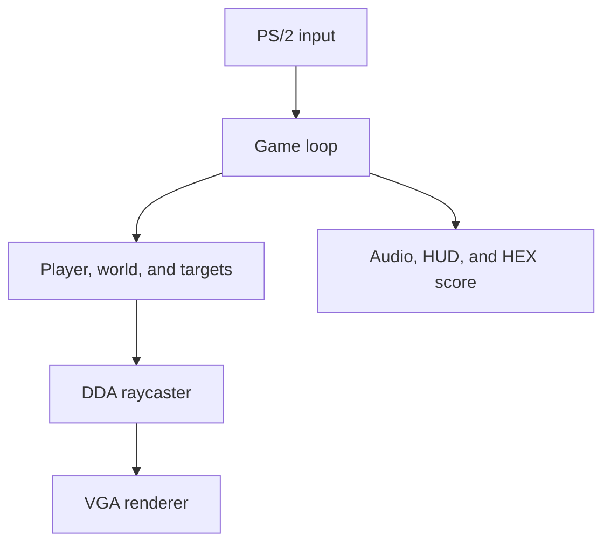

# Architecture

3D Shooting is organized as a small bare-metal game loop around four hardware-facing outputs: VGA, the character buffer, audio, and the HEX display. PS/2 keyboard and mouse ports provide input.

## Runtime flow

1. `main()` initializes the camera lookup table, targets, VGA buffers, audio state, and PS/2 mouse.
2. The title screen is drawn and the program waits for `G`.
3. `refresh()` resets the player, targets, main key/button flags, health, score, and scope state.
4. The main loop polls input, applies movement and rotation, processes shots, advances timers, renders a frame, and updates the outputs.
5. A depleted health value, completed target set, or `X` input enters the end state. Pressing `R` returns to the title screen.

## Rendering pipeline

### Fixed-point camera

Positions, direction vectors, camera-plane values, and distances use signed Q16.16 values. `fixed.c` supplies multiplication and division with a 64-bit intermediate so that the renderer does not depend on floating-point operations.

### DDA raycasting

`raycast_column()` creates a ray from the player direction and a precomputed camera-x value, then calls `raycast_ray()` with explicit Q16.16 `rayDirX` and `rayDirY` values. `fire_center()` calls the same read-only core with the player's direction. This is the only DDA traversal implementation: it advances through the 16 × 16 map grid along the nearest x or y boundary until it reaches a wall.

`RayHit` retains wall distance/side and the nearest target distance for rendering, and adds the first occupied cell's `targetX`/`targetY` for shooting (`-1` when absent). Equal boundary distances still step in y first. Each cell's target is recorded before its wall check, preserving shots at targets occupying a wall cell. Target visibility, kills, score, cooldown, and audio remain caller responsibilities; the core does not mutate game state.

For every one of the 320 logical columns, `render_frame()` stores the wall distance in `zBuffer`, projects wall and target heights, and builds an intermediate character view. This depth test prevents a target behind a wall from being drawn.

### VGA composition

`vga_render_one_frame()` converts the intermediate view into RGB565 pixels. It applies a sky/floor gradient, distance-based wall brightness, edge highlighting, target color, and either the gun/crosshair or the circular scope overlay. The health bar is composed last, then the pixel-buffer controller swaps the front and back buffers.

## Module map

| Module | Role |
| --- | --- |
| `main`, `game` | Application lifecycle, game loop, and state reset |
| `common`, `fixed` | Shared data types, constants, and Q16.16 arithmetic |
| `world` | Static wall map, target occupancy grid, and collision query |
| `player` | Movement, rotation, firing direction, and hit processing |
| `target` | Target initialization, horizontal movement, and shared target state |
| `raycast` | Camera lookup table, DDA traversal, depth buffer, and scene projection |
| `render`, `cover` | RGB565 frames, character HUD, overlays, and title screen |
| `input` | PS/2 keyboard scan codes and three-byte mouse packets |
| `audio` | Audio FIFO streaming and one-shot playback state |
| `HEX` | Four-digit seven-segment score encoding |
| `hw` | Memory-mapped peripheral pointers |
| `assets` | Compiled image and audio arrays |

## Memory-mapped I/O

These values come directly from `include/hw.h` and must agree with the selected hardware or simulator configuration.

| Region or device | Address | Use |
| --- | ---: | --- |
| SDRAM | `0x00000000`–`0x03FFFFFF` | Frame buffers are computed near the top of this range |
| Character buffer | `0x09000000` | Text HUD and end-state messages |
| PS/2 keyboard | `0xFF200100` | Keyboard scan-code input |
| PS/2 mouse | `0xFF200108` | Mouse packets and enable command |
| HEX display | `0xFF200020` | Four-digit score output |
| VGA pixel-buffer controller | `0xFF203020` | Buffer addresses, swap command, and status |
| Audio core | `0xFF203040` | FIFO status and stereo samples |

## Data ownership

- `wallMap` is immutable; `targetGrid` is rebuilt at the start of each game.
- `Player` is owned by `main()` and passed to movement, shooting, raycasting, and reset functions.
- Keyboard, mouse, HUD, target, health, and sound states are module-level variables because the program uses one application instance.
- Image and sound samples are compiled into the executable, so no file system is required at runtime.
